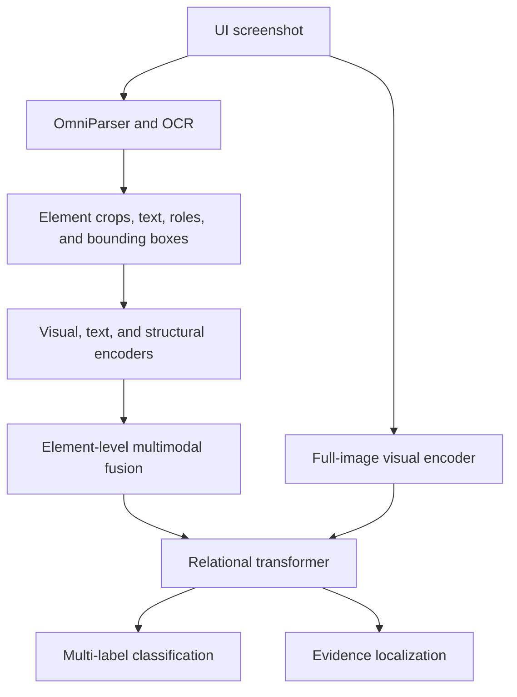

# Dark Pattern Detector

A research project for identifying potentially manipulative interface patterns in website and app screenshots using visual, textual, and structural evidence.

Based on [Misleading Patterns — CDS Onboarding](https://docs.google.com/document/d/1w7mKr95aSBic2trthV9Wxaq-8utEPkl5tnn_mZmZJj8/edit?tab=t.0), including its model-design diagrams.

## Status and scope

**Environment setup ready; implementation pending.** The repository includes the research outline, a [four-owner implementation plan](IMPLEMENTATION_PLAN.md), and a shared Python environment. Baseline and model code are the next tasks.

## Development setup

Use **Python 3.11**, **uv** for environment/dependency management, **scikit-learn** for TF-IDF and logistic regression, and **PyTorch** for the UI encoder and transformer. The one-hour prototype runs on CPU; no GPU is required.

1. Install uv using the [official installation instructions](https://docs.astral.sh/uv/getting-started/installation/).
2. From the repository root, create the environment and install the locked dependencies:

   ```sh
   uv sync --locked
   ```


`uv` manages `.venv/` and selects Python 3.11 using `.python-version`. Commit `pyproject.toml`, `uv.lock`, and `.python-version`; keep the environment and raw `dataset/` directory out of Git. See the [uv project guide](https://docs.astral.sh/uv/guides/projects/) for environment and lockfile behavior.

### Code to write for the first milestone

The environment configuration is sufficient to start; the four owners will create the files assigned in [IMPLEMENTATION_PLAN.md](IMPLEMENTATION_PLAN.md). Once those files exist, run them through the shared environment:

```sh
uv run python baseline.py --data examples/baseline_sample.jsonl
uv run python ui_encoder.py
uv run python fusion_model.py
```

These implementation commands are planned and will work after their respective owners deliver the scripts. OmniParser, CLIP, and MiniLM integration is deferred; add their dependencies when that work begins. Use `uv add PACKAGE` for agreed new dependencies and commit both the updated project file and lockfile.

## Research objective

Compare text-only, vision-only, UI-structure, and multimodal approaches to determine which signals help identify dark patterns. The intended output is a set of pattern predictions with scores and supporting UI elements or regions.

The onboarding document also proposes a smaller click-to-cancel MVP: parse an interface with OmniParser and use a model to assess cancellation-related UI. Verifying that cancellation actually succeeds would require interaction evidence beyond a single screenshot. The MVP and the broader research pipeline are separate possible implementation scopes.

## Detection categories

| Candidate category | Example evidence | Interpretation limit |
| --- | --- | --- |
| False urgency | Countdown timers or urgency language | A screenshot can reveal urgency cues, but cannot establish that the urgency is false. |
| Visual interference | A prominent Accept button and a low-visibility Reject button | Assess relative size, contrast, and placement in context. |
| Hidden costs | Fee disclosures in small or low-visibility text | Additional screens or pricing context may be needed to establish that a cost was hidden. |
| Confirmshaming | Emotionally manipulative refusal wording | Retain the exact text and its surrounding choice. |
| Sneaking / preselection | A paid optional add-on already selected | Selection state and pricing context are relevant evidence. |

Multiple categories may apply to one screenshot. An **insufficient evidence** outcome should be distinct from a negative prediction. The model-design diagram uses related labels such as urgency/scarcity cues and low-visibility disclosures; the final taxonomy must reconcile these observable cues with the broader categories above.

## Proposed architecture

The design combines parsed UI elements with a full-image visual branch that preserves information the parser may miss.



| Component | Responsibility | Candidates in the onboarding document |
| --- | --- | --- |
| Input processing | Load screenshots and optional HTML | Pillow, BeautifulSoup |
| UI parsing | Extract text, UI regions, bounding boxes, and element roles | OmniParser V2, AidUI UIED, OCR |
| Visual encoding | Represent the screenshot and individual element crops | CLIP / ViT, ResNet |
| Text encoding | Represent UI wording | MiniLM, DeBERTa-v3-small, BERT, RoBERTa |
| Structural encoding | Represent geometry, relative prominence, contrast, and roles | OpenCV, bounding-box features, MLP |
| Fusion | Combine visual, text, and structural representations | Concatenation with an MLP; relational or cross-modal attention |
| Prediction | Produce pattern scores and supporting regions | Multi-label sigmoid classifier, element-localization head |
| Results interface | Present predictions and evidence | React with FastAPI, if a demo is included in a later scope |

For element `i`, the proposed fusion is `z_i = MLP([v_i; t_i; s_i])`, where `v_i`, `t_i`, and `s_i` are its visual, textual, and structural embeddings. The model-design diagrams propose a shared 256-dimensional representation and a relational transformer with two layers and eight attention heads.

The source contains two related transformer designs: one combines element tokens with full-image patch tokens; the other uses an Element-Aware Multimodal Transformer (EAMT) with a global screenshot token and a maximum of 64 UI elements. These are design candidates, not a finalized implementation. The choice of global representation, element-selection policy, and localization supervision remains open.

## Research plan

### Recommended starting dataset: ContextDP

[ContextDP](https://github.com/SageSELab/AidUI/tree/master/evaluation/evaluation_dataset) is the recommended starting point for a screenshot-based experiment. It includes web and mobile screenshots with dark-pattern categories and bounding-box annotations, making it suitable for comparing text-only, visual, and UI-element approaches. The [AidUI paper](https://arxiv.org/abs/2303.06782) describes its construction and evaluation.

- **Access:** [Download the dataset archive](https://github.com/SageSELab/AidUI/releases/download/v-ICSE'23-data/AidUI-Evaluation-Dataset.tar.gz). The images and annotations are also available in the AidUI repository under `evaluation/evaluation_dataset/`, separated into `web` and `mobile` directories. Each has an `images/` directory and a `result.json` annotation file.
- **Size:** The authors report 162 web and 339 mobile screenshots, depicting 301 dark-pattern and 243 non-dark-pattern instances. These are instance counts, not counts of positive and negative screenshots; a screenshot can contain multiple instances.
- **Annotations:** The JSON files contain image metadata, category IDs, and instance bounding boxes. Categories differ between the web and mobile subsets; both include `NO DP`. Review how instance annotations should become screenshot-level labels before training.
- **Text:** The inspected annotation files do not include transcribed UI text. Extract it from screenshots with OCR or OmniParser for the text baseline and review extraction quality.
- **Scope and limitations:** ContextDP is small and consists of static screenshots. It cannot establish behavior across a user journey, such as whether cancellation succeeds. Check category frequencies and source identities before creating splits; group related screenshots by website or app where that information is available. Confirm dataset reuse terms before redistribution or publication; the repository's code license does not by itself establish rights to every screenshot.

The source README reports 544 instances, while the two annotation files contain 546 annotation records in total. Resolve this discrepancy and inspect `NO DP` annotations before calculating class counts or interpreting negatives. The dataset has not yet been imported or processed in this project.

### 1. Prepare and standardize data

Inspect ContextDP's annotations and source identities for the first experiment. Consider Dark Patterns at Scale and custom labeled screenshots for later expansion after checking their modalities and annotations.

Define a shared representation for screenshot identity, source domain, extracted text, UI elements, bounding boxes, and category labels. Record which samples have localization annotations and which require additional context. Reconcile label differences before combining datasets.

### 2. Establish evaluation splits

Create train, validation, and test splits separated by website or app source to reduce leakage. Keep duplicate or closely related screenshots together. Use the validation split for model selection and reserve the test split for final comparisons.

### 3. Implement controlled baselines

| Experiment | Input | Research question |
| --- | --- | --- |
| NLP-only | Extracted UI text | How much can wording explain? |
| CV-only | Raw screenshot | How much can appearance explain? |
| UI structure | Bounding boxes and geometric features | How much can layout explain? |
| Pretrained VLM | Screenshot with text | How well does pretrained multimodal reasoning perform? |
| Learned multimodal model | Visual, textual, and structural features | Does learned fusion improve detection and localization? |

Use consistent labels and data splits across comparisons. Record differences in available input, pretraining, and supervision so results can be interpreted fairly.

### 4. Train and evaluate fusion models

Compare simple MLP fusion with the proposed relational transformer. Evaluate macro-F1, precision, recall, AUROC, and per-category F1. Add a localization metric when bounding-box or element-level annotations support it; choose the metric to match those annotations.

Run ablations that remove the visual, textual, and structural branches individually. Compare the contribution of full-image features with parsed element features, and inspect errors caused by OCR or UI parsing.

### 5. Report findings

Report performance by category, ablation results, and representative errors with supporting screenshots or UI regions. Document dataset versions, splits, preprocessing, model configurations, random seeds, and decision thresholds alongside each experiment. Report insufficient-evidence outcomes separately so they are not silently counted as clean interfaces.

## Decisions before implementation

- Choose the first deliverable: cancellation-focused MVP, a baseline experiment, or the broader research pipeline.
- Confirm ContextDP's suitability after inspecting its labels, negative examples, source identities, and available reuse terms; reconcile its categories with the project taxonomy.
- Confirm available compute and whether models run locally or use a hosted API.
- Select a fusion architecture and the supervision available for localization.
- Decide whether the deliverable needs a CLI, notebooks, an API, or an interactive demo.

## References

- [Project onboarding and model design](https://docs.google.com/document/d/1w7mKr95aSBic2trthV9Wxaq-8utEPkl5tnn_mZmZJj8/edit?tab=t.0)
- [AidUI](https://github.com/SageSELab/AidUI)
- [Microsoft OmniParser](https://github.com/microsoft/OmniParser)
- [Dark Patterns at Scale data](https://github.com/aruneshmathur/dark-patterns/tree/master/data)

These are references from the onboarding document; no external code, model weights, or datasets have been incorporated into this repository.
