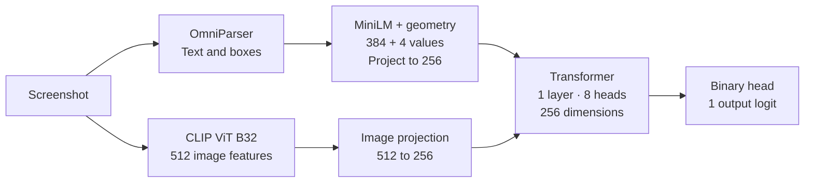

# Dark Pattern Detector

*Weekly progress summary*

November 7 to November 14 2026  |  Cornell Data Science

This week, we moved from a research outline to a working text classifier and a connected screenshot model. The text baseline reached 94.16% accuracy and 0.9414 macro-F1 on 565 held-out texts. The screenshot model passed forward and backward checks with real parsed UI elements. Multimodal training and performance evaluation are the next milestone.

## Dataset introduction

We use two complementary datasets: an e-commerce text corpus for the text baseline and ContextDP screenshots for the visual and UI pipeline.

**E-commerce text corpus.** Yada et al.'s *Dark patterns in e-commerce: a dataset and its baseline evaluations* (IEEE BigData 2022) provides 2,356 labeled text snippets from 1,248 page IDs, with 1,178 positive and 1,178 negative examples before deduplication. Each record includes the text, page ID, binary label, and pattern category. Positive categories include Urgency, Scarcity, Social Proof, Misdirection, Obstruction, Sneaking, and Forced Action. The corpus combines dark-pattern text from Mathur et al. (2019) with collected non-dark-pattern website text. It supplies the labels and inputs for our reported text-classification results; it contains no screenshots or bounding boxes.

**ContextDP.** This screenshot dataset, distributed with AidUI, includes website and mobile interfaces annotated with dark-pattern categories and bounding boxes. Its web subset contains 162 screenshots, with cues such as countdown timers, low-stock messages, default choices, and attention distraction, alongside `NO DP` annotations. This week, we used eight manually transcribed web examples for initial pipeline checks and one screenshot for OmniParser and fusion integration. ContextDP provides the visual context and spatial annotations needed for the next screenshot-based experiment.

Both datasets retain their original annotations. The text corpus measures recognition of labeled wording, while ContextDP supports studying how appearance and layout contribute to detection.

## Work completed

**Real data and provenance.** Prepared ContextDP text excerpts, balanced across positive and negative labels. The full e-commerce corpus now supports a larger text experiment.

**Text baseline and evaluation.** Implemented TF-IDF word unigrams and bigrams with logistic regression. Added normalized-text deduplication, grouped splitting, a majority-class comparison, and saved metrics and predictions for reproducibility.

**Screenshot parsing.** Ran OmniParser on a real ContextDP screenshot and exported 59 elements with text and normalized bounding boxes, alongside native records and an annotated image. Recorded OCR and generated-caption errors for later review.

**Multimodal integration.** Connected frozen MiniLM text embeddings and box coordinates to 256-dimensional UI tokens, then combined them with frozen CLIP screenshot features in a transformer classifier. Padding masks support variable element counts and empty UI records.

## Implemented screenshot model

The real screenshot produced 59 UI tokens. Gradients reached the UI projection and fusion layers while CLIP and MiniLM remained frozen. The current head produces one binary logit; its trainable layers are still untrained.

## Text baseline results

The full Yada et al. e-commerce corpus contains 2,356 labeled texts. Removing 98 normalized-text duplicates left 2,258 examples: 1,693 for training and 565 for evaluation. Pages connected by duplicate text stayed together; the partitions share zero page IDs and zero normalized texts.

| Metric | TF-IDF + logistic regression | Majority-class baseline |
| --- | ---: | ---: |
| Accuracy | 94.16% | 51.68% |
| Macro-F1 | 0.9414 | 0.3407 |
| Positive precision | 96.88% | 0.00% |
| Positive recall | 90.84% | 0.00% |
| AUROC | 0.9832 | 0.5000 |

One fixed grouped holdout, seed 42, with TF-IDF fitted only on training text and no hyperparameter or threshold tuning. Positive means a source-labeled dark pattern.

## What the results show

The classifier correctly identified 248 of 273 positives and 284 of 292 negatives, with 25 missed positives and eight false alarms. Misdirection accounted for 14 of the 25 misses; its recall was 71.43%, compared with 97.94% for Scarcity. This makes misdirection a useful focus for error analysis.

These results measure text classification on one corpus and one holdout. The data has page IDs but no domain field, so separation by website is not established. Near-duplicate templates may remain, and rare categories have limited coverage. Screenshot-model accuracy still needs a separate experiment.

## Next priorities

1. Audit ContextDP labels and source identities, then prepare consistent extracted text and source-grouped screenshot splits.

2. Train the UI projection and fusion classifier. Compare text-only, image-only, and multimodal models on the same screenshot split, with ablations for text and geometry.

3. Review missed categories, OCR and caption errors, and CLIP center-crop losses. Use the findings to guide extraction and preprocessing changes.

**Supporting evidence**  [Data](https://github.com/CornellDataScience/dark-pattern-detector/blob/9418aeb8633d877671eab444771d64c1793d62a6/reports/data_progress.md) · [Baseline evaluation](https://github.com/CornellDataScience/dark-pattern-detector/blob/9418aeb8633d877671eab444771d64c1793d62a6/reports/baseline_progress.md) · [Parsing report](https://github.com/CornellDataScience/dark-pattern-detector/blob/9418aeb8633d877671eab444771d64c1793d62a6/reports/omniparser_progress.md) · [Current implementation](https://github.com/CornellDataScience/dark-pattern-detector/blob/9418aeb8633d877671eab444771d64c1793d62a6/README.md)

Repository progress from 70568bb to 9418aeb. Checks repeated on November 14 2026.
